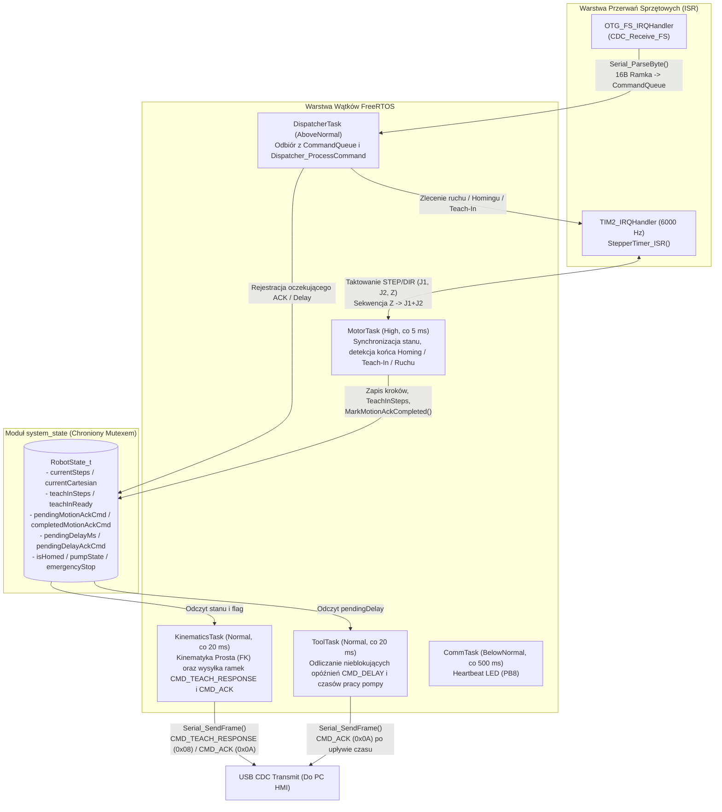

# Dokumentacja Techniczna Firmware GINO_RTOS (Od A do Z)

Kompleksowy opis architektury, konfiguracji sprzętowej, maszyn stanów, protokołu komunikacji binarnej oraz przepływu danych w oprogramowaniu wbudowanym czasu rzeczywistego **GINO_RTOS** dla 3-osiowego manipulatora **SCARA** na mikrokontrolerze **STM32F401CCU6**.

---

## Spis Treści

1. [Platforma Sprzętowa i Konfiguracja Zegarów](#1-platforma-sprzętowa-i-konfiguracja-zegarów)
2. [Mapowanie Pinów (GPIO Pinout)](#2-mapowanie-pinów-gpio-pinout)
3. [Struktura Plików i Modułów Projektu](#3-struktura-plików-i-modułów-projektu)
4. [Konfiguracja Mechaniczna i Parametry Robota (`config.h`)](#4-konfiguracja-mechaniczna-i-parametry-robota-configh)
5. [Architektura Czasu Rzeczywistego (FreeRTOS + Sprzętowy Timer TIM2)](#5-architektura-czasu-rzeczywistego-freertos--sprzętowy-timer-tim2)
   - [Sprzętowy Generator Kroków (`TIM2_IRQHandler`)](#51-sprzętowy-generator-kroków-tim2_irqhandler)
   - [Zadania FreeRTOS (Tasks)](#52-zadania-freertos-tasks)
   - [Kolejki i Synchronizacja (Mutexy / Cyfrowy Bliźniak)](#53-kolejki-i-synchronizacja-mutexy--cyfrowy-bliźniak)
6. [Szczegółowy Opis Modułów (`Modules/`)](#6-szczegółowy-opis-modułów-modules)
   - [`tmc2209_stepper` – Maszyna Stanów Silników i Krańcówek](#61-tmc2209_stepper--maszyna-stanów-silników-i-krańcówek)
   - [`serial_interface` – Parser i Nadajnik Ramek Binarnych 16B](#62-serial_interface--parser-i-nadajnik-ramek-binarnych-16b)
   - [`dispatcher` – Główny Dyspozytor Poleceń](#63-dispatcher--główny-dyspozytor-poleceń)
   - [`system_state` – Cyfrowy Bliźniak Robota (Digital Twin)](#64-system_state--cyfrowy-bliźniak-robota-digital-twin)
   - [`inverse_kinematics` – Kinematyka Prosta (FK) i Odwrotna (IK)](#65-inverse_kinematics--kinematyka-prosta-fk-i-odwrotna-ik)
   - [`tool_controller` – Sterowanie Chwytakiem / Pompą Próżniową](#66-tool_controller--sterowanie-chwytakiem--pompą-próżniową)
7. [Protokół Komunikacji Binarnej (16 Bajtów: STM32 <-> PC HMI)](#7-protokół-komunikacji-binarnej-16-bajtów-stm32---pc-hmi)
8. [Kluczowe Algorytmy i Scenariusze Pracy (Krok po Kroku)](#8-kluczowe-algorytmy-i-scenariusze-pracy-krok-po-kroku)
   - [Sekwencyjne Bazowanie (`Z -> J1 + J2`)](#81-sekwencyjne-bazowanie-z---j1--j2)
   - [Algorytm Uczenia Pozycji `Teach-In` (Inżynieria Odwrotna Pozycji)](#82-algorytm-uczenia-pozycji-teach-in-inżynieria-odwrotna-pozycji)
   - [Wykonywanie Programów SCADA w Trybie Stop-and-Wait (`CMD_ACK`)](#83-wykonywanie-programów-scada-w-trybie-stop-and-wait-cmd_ack)
9. [Kompilacja i Wgrywanie Firmware](#9-kompilacja-i-wgrywanie-firmware)

---

## 1. Platforma Sprzętowa i Konfiguracja Zegarów

* **Mikrokontroler:** `STM32F401CCU6` (rdzeń ARM Cortex-M4F ze sprzętową jednostką zmiennoprzecinkową FPU, 256 KB Flash, 64 KB SRAM).
* **Zegar Systemowy (`SystemClock_Config` w `Core/Src/main.c`):**
  * Zewnętrzny rezonator kwarcowy **HSE = 25 MHz** (`PH0`, `PH1`).
  * Pętla PLL (`PLLM = 25`, `PLLN = 336`, `PLLP = DIV4`, `PLLQ = 7`):
    * **`SYSCLK` / `HCLK` (CPU, AHB):** **84 MHz**
    * **`PCLK1` (APB1 Peripherals):** **42 MHz** (**`APB1 Timer Clock` = 84 MHz**)
    * **`PCLK2` (APB2 Peripherals & Timers):** **84 MHz**
    * **`USB OTG FS Clock`:** **48 MHz** (`336 MHz / 7`)
* **Podstawa Czasu HAL (`Core/Src/stm32f4xx_hal_timebase_tim.c`):**
  * `TIM1` skonfigurowany na przerwanie co **1 ms** (1 kHz) do inkrementacji `uwTick`, podczas gdy `SysTick` napędza scheduler **FreeRTOS** (1000 Hz).

---

## 2. Mapowanie Pinów (GPIO Pinout)

Zdefiniowane w `Core/Inc/main.h` oraz inicjalizowane w `Core/Src/gpio.c`:

| Podsystem | Etykieta w Kodzie | Pin STM32 | Tryb GPIO | Logika Elektryczna i Funkcja |
| :--- | :--- | :---: | :--- | :--- |
| **Oś J1 (Ramię Główne)** | `J1_STEP_Pin` | **PA10** | Output Push-Pull | Impuls kroku `STEP` dla sterownika TMC2209 #1 |
| | `J1_DIR_Pin` | **PA1** | Output Push-Pull | Kierunek: `RESET` = dodatni (`+1`), `SET` = do bazy (`-1`) |
| | `J1_ENABLE_Pin` | **PA2** | Output Push-Pull | Aktywny niski: `RESET` = prąd załączony, `SET` = luźny (Teach-In) |
| | `J1_LIMIT_Pin` | **PA3** | Input Pull-Up | Krańcówka J1: `SET` = zwolniona, `RESET` (GND) = wciśnięta |
| **Oś J2 (Przedramię)** | `J2_STEP_Pin` | **PA4** | Output Push-Pull | Impuls kroku `STEP` dla sterownika TMC2209 #2 |
| | `J2_DIR_Pin` | **PA5** | Output Push-Pull | Kierunek: `RESET` = dodatni (`+1`), `SET` = do bazy (`-1`) |
| | `J2_ENABLE_Pin` | **PA6** | Output Push-Pull | Aktywny niski: `RESET` = prąd załączony, `SET` = luźny (Teach-In) |
| | `J2_LIMIT_Pin` | **PA7** | Input Pull-Up | Krańcówka J2: `SET` = zwolniona, `RESET` (GND) = wciśnięta |
| **Oś Z / J3 (Pionowa)** | `Z_STEP_Pin` | **PB0** | Output Push-Pull | Impuls kroku `STEP` dla sterownika TMC2209 #3 |
| | `Z_DIR_Pin` | **PB1** | Output Push-Pull | Kierunek: `RESET` = dodatni (`+1`), `SET` = do bazy (`-1`) |
| | `Z_ENABLE_Pin` | **PB10** | Output Push-Pull | Aktywny niski: `RESET` = prąd załączony, `SET` = luźny (Teach-In) |
| | `Z_LIMIT_Pin` | **PB12** | Input Pull-Up | Krańcówka Z: `SET` = zwolniona, `RESET` (GND) = wciśnięta |
| **Narzędzie (Efektor)** | `PUMP_PIN_Pin` | **PB13** | Output Push-Pull | Sterowanie pompą próżniową (`SET` = ON, `RESET` = OFF) |
| **Bezpieczeństwo** | `ESTOP_PIN_Pin` | **PB14** | Input Pull-Up | Fizyczny grzyb E-STOP (`RESET` = wciśnięty alarm) |
| **Status / LED** | `COMMS_LED_Pin` | **PB8** | Output Push-Pull | Dioda sygnalizacyjna pracy systemu (Heartbeat 1 Hz) |
| **Interfejs USB CDC** | `USB_DM` / `USB_DP`| **PA11 / PA12** | AF10 (`OTG_FS`) | Wirtualny port szeregowy USB Full-Speed (komunikacja z PC) |
| **Dodatkowe Peryferia**| `UART_TMC_Pin` | **PA9** | AF7 Open-Drain | `USART1_TX` Half-Duplex (115200 bps pod diagnostykę TMC2209) |
| | `I2C1` / `SPI1` | **PB6..PB7 / PA15..PB5** | AF4 / AF5 | Zarezerwowane magistrale rozszerzeń na PCB |

---

## 3. Struktura Plików i Modułów Projektu

```text
GINO_RTOS/
├── Core/
│   ├── Inc/
│   │   ├── config.h                    # Główny plik konfiguracyjny mechaniki, przełożeń, limitów i prędkości
│   │   ├── main.h                      # Definicje pinów GPIO
│   │   ├── FreeRTOSConfig.h            # Konfiguracja jądra FreeRTOS
│   │   └── stm32f4xx_it.h              # Nagłówki procedur obsługi przerwań
│   └── Src/
│       ├── main.c                      # Inicjalizacja HAL, zegarów (84 MHz), peryferiów i start FreeRTOS
│       ├── freertos.c                  # Konfiguracja TIM2, zadania FreeRTOS, kolejka komend i koordynacja osi
│       ├── gpio.c                      # Inicjalizacja portów GPIOA i GPIOB
│       ├── stm32f4xx_it.c              # Wektory przerwań (TIM1, TIM2_IRQHandler, OTG_FS_IRQHandler)
│       └── stm32f4xx_hal_timebase_tim.c# Konfiguracja TIM1 jako podstawy czasu HAL
│
├── Modules/
│   ├── tmc2209_stepper/                # Sterownik silników krokowych, krańcówek, Homingu i Teach-In
│   │   ├── tmc2209_stepper.h
│   │   └── tmc2209_stepper.c
│   ├── serial_interface/               # Protokół binarny 16B (Parser RX + Nadajnik TX z sumą XOR)
│   │   ├── serial_interface.h
│   │   └── serial_interface.c
│   ├── dispatcher/                     # Dyspozytor rozkazów binarnych i logika sterowania
│   │   ├── dispatcher.h
│   │   └── dispatcher.c
│   ├── system_state/                   # Bezpieczny wątkowo (Mutex) stan robota (Digital Twin)
│   │   ├── system_state.h
│   │   └── system_state.c
│   ├── inverse_kinematics/             # Kinematyka prosta (FK) i odwrotna (IK) dla geometrii SCARA
│   │   ├── inverse_kinematics.h
│   │   └── inverse_kinematics.c
│   └── tool_controller/                # Sterownik efektora końcowego (pompy próżniowej)
│       ├── tool_controller.h
│       └── tool_controller.c
│
├── USB_DEVICE/
│   └── App/usbd_cdc_if.c               # Obsługa USB CDC: przekazywanie odebranych bajtów do Serial_ParseByte()
│
├── TEACH_IN_PROTOCOL.md                # Specyfikacja protokołu 16B dla aplikacji Python GINO_HMI
└── CODE_ARCHITECTURE_A_TO_Z.md         # Niniejsza dokumentacja kodu od A do Z
```

---

## 4. Konfiguracja Mechaniczna i Parametry Robota (`config.h`)

Plik [`Core/Inc/config.h`](file:///c:/Users/Ignacy/OneDrive/Dokumenty/Projekty/Gino/GINO_RTOS/Core/Inc/config.h) skupia w jednym miejscu wszystkie stałe fizyczne robota:

1. **Silniki i Mikrokrok:**
   * `MOTOR_STEPS_PER_REV = 200.0f` ($1.8^\circ/\text{krok}$)
   * `MICROSTEPS_J1 = 8.0f`, `MICROSTEPS_J2 = 8.0f`, `MICROSTEPS_Z = 8.0f`
2. **Przełożenia Mechaniczne i Przeliczniki Kroków:**
   * `GEAR_RATIO_J1 = 3.75f`, `GEAR_RATIO_J2 = 3.75f`
   * `GEAR_RATIO_Z = 1.0f`, `Z_SCREW_LEAD_MM = 8.0f` (śruba trapezowa Tr8x8: $8\text{ mm/obrót}$)
   * **Automatycznie wyliczane stałe:**
     * `STEPS_PER_DEG_J1` = $\frac{200 \cdot 8 \cdot 3.75}{360} = 16.6667\text{ kroków}/^\circ$
     * `STEPS_PER_DEG_J2` = $\frac{200 \cdot 8 \cdot 3.75}{360} = 16.6667\text{ kroków}/^\circ$
     * `STEPS_PER_MM_Z` = $\frac{200 \cdot 8 \cdot 1.0}{8.0} = 200.0\text{ kroków/mm}$
3. **Geometria SCARA i Limity Programowe (Soft Limits):**
   * `L1_LENGTH = 100.0f` mm, `L2_LENGTH = 100.0f` mm
   * Offsety bazowe: `J1_HOME_ANGLE_DEG = 0.0f`, `J2_HOME_ANGLE_DEG = 0.0f`, `Z_HOME_POS_MM = 0.0f`
   * Maksymalne zakresy ruchu od krańcówki (`0`):
     * `J1_MAX_TRAVEL_DEG = 180.0f` (`J1_MAX_STEPS = 3000` kroków)
     * `J2_MAX_TRAVEL_DEG = 180.0f` (`J2_MAX_STEPS = 3000` kroków)
     * `Z_MAX_TRAVEL_MM = 100.0f` (`Z_MAX_STEPS = 20000` kroków)
4. **Częstotliwość Taktowania Silników (`TIM2`):**
   * `STEPPER_BASE_FREQ_HZ = 3000U` (częstotliwość bazowa = 3000 kroków/s)
   * `Z_STEP_DIVIDER = 1U` $\rightarrow$ **Oś Z pracuje z częstotliwością $3000\text{ Hz}$** ($15\text{ mm/s}$)
   * `J1_J2_STEP_DIVIDER = 3U` $\rightarrow$ **Osie J1 i J2 pracują z częstotliwością $1000\text{ Hz}$** ($60^\circ/\text{s}$)

---

## 5. Architektura Czasu Rzeczywistego (FreeRTOS + Sprzętowy Timer TIM2)



### 5.1. Sprzętowy Generator Kroków (`TIM2_IRQHandler`)
Aby całkowicie wyeliminować blokujące pętle opóźniające `for (volatile int i...)` oraz jitter schedulera FreeRTOS, generacja sygnałów `STEP` została przeniesiona do sprzętowego 32-bitowego timera **`TIM2`** ([`Core/Src/freertos.c`](file:///c:/Users/Ignacy/OneDrive/Dokumenty/Projekty/Gino/GINO_RTOS/Core/Src/freertos.c#L60-L132) oraz [`Core/Src/stm32f4xx_it.c`](file:///c:/Users/Ignacy/OneDrive/Dokumenty/Projekty/Gino/GINO_RTOS/Core/Src/stm32f4xx_it.c#L192-L199)):
* Zegar wejściowy `TIM2` wynosi $84\text{ MHz}$. Preskaler `PSC = 83` daje taktowanie licznika $1\text{ MHz}$ ($1\,\mu\text{s}$).
* Rejestr `ARR` jest ustawiony na `1000000 / (STEPPER_BASE_FREQ_HZ * 2) - 1`, co przy `3000 Hz` daje przerwanie co **$166.6\,\mu\text{s}$ ($6000\text{ Hz}$)**.
* Przerwanie `StepperTimer_ISR()` działa dwufazowo (`stepPinHighPhase`):
  1. **Faza 1 (`stepPinHighPhase == false`):**
     * Wywołuje `Stepper_UpdateStateMachine()` dla `motorJ1`, `motorJ2`, `motorZ`. Jeśli dla danej osi nadszedł cykl kroku (zgodnie z jej dzielnikiem `stepDivider`), funkcja `move_one_step()` wystawia stan wysoki **`GPIO_PIN_SET`** na pinie `STEP`.
     * Nadzoruje przejście z etapu 1 do etapu 2 w sekwencyjnym bazowaniu (`pendingHomeJ1J2` oraz `pendingTeachReturnJ1J2`): gdy `motorZ` dotknie krańcówki i przejdzie w `STATE_IDLE`, natychmiast wyzwala bazowanie dla `motorJ1` i `motorJ2`.
     * Sprawdza programowe limity maksymalnego wychylenia (`J1_MAX_STEPS`, `J2_MAX_STEPS`, `Z_MAX_STEPS`).
  2. **Faza 2 (`stepPinHighPhase == true`, w kolejnym przerwaniu po $166.6\,\mu\text{s}$):**
     * Wystawia stan niski **`GPIO_PIN_RESET`** na pinach `STEP` wszystkich trzech silników.
  * **Efekt:** Zero blokowania CPU (`0` pustych pętli), szerokość impulsu `STEP` to zawsze równe $166.6\,\mu\text{s}$ (ponad 1600 razy więcej niż minimalne $100\text{ ns}$ wymagane przez TMC2209), a praca silników jest idealnie płynna i niezależna od obciążenia wątków FreeRTOS.

### 5.2. Zadania FreeRTOS (Tasks)

| Wątek | Priorytet | Okres / Wyzwalanie | Odpowiedzialność w Kodzie (`Core/Src/freertos.c`) |
| :--- | :--- | :---: | :--- |
| **`MotorTask`** | `osPriorityHigh` | `osDelay(5)` (200 Hz) | Przepisuje bieżące pozycje krokowe silników do `SystemState`. Wykrywa moment zakończenia bazowania wszystkich 3 osi (`SystemState_SetHomed(true)`), moment zakończenia pomiaru `Teach-In` (`SystemState_SetTeachInSteps()`) oraz moment przejścia wszystkich 3 silników w `STATE_IDLE` po wykonaniu ruchu (`SystemState_MarkMotionAckCompleted()`). W razie aktywnego `E-STOP` zatrzymuje silniki. |
| **`DispatcherTask`** | `osPriorityAboveNormal` | Kolejka `CommandQueue` (timeout 10 ms) | Inicjalizuje stos USB CDC (`MX_USB_DEVICE_Init()`). Monitoruje fizyczny przycisk `ESTOP_PIN` (`PB14`). Odbiera 16-bajtowe ramki `CommandFrame_t` z kolejki `CommandQueue` i przekazuje je do `Dispatcher_ProcessCommand(&frame)`. |
| **`KinematicsTask`** | `osPriorityNormal` | `osDelay(20)` (50 Hz) | Na bieżąco przelicza aktualne kroki robota na współrzędne $(X, Y, Z)$ w `SystemState`. Jeśli pojawiły się nowe kroki z procedury `Teach-In` (`SystemState_ConsumeTeachInSteps`), przelicza je przez kinematykę prostą i wysyła do PC ramkę `CMD_TEACH_RESPONSE (0x08)`. Jeśli zakończył się ruch robota (`SystemState_ConsumeCompletedMotionAck`), wysyła do PC ramkę `CMD_ACK (0x0A)`. |
| **`ToolTask`** | `osPriorityNormal` | `osDelay(20)` (50 Hz) | Odbiera z `SystemState` zlecenia opóźnień czasowych (`SystemState_ConsumePendingDelay`) dla komendy `CMD_DELAY (0x09)` lub czasowego załączenia efektora, odlicza zadany czas w krokach po 20 ms (z natychmiastowym przerwaniem w razie `E-STOP`) i po jego upływie odsyła do PC ramkę `CMD_ACK (0x0A)`. |
| **`CommTask`** | `osPriorityBelowNormal` | `osDelay(500)` (2 Hz) | Przełącza diodę `COMMS_LED` (`PB8`) sygnalizując prawidłowe działanie schedulera RTOS. |

### 5.3. Kolejki i Synchronizacja (Mutexy / Cyfrowy Bliźniak)
* **`CommandQueueHandle`:** Kolejka komunikatów FreeRTOS o głębokości **10 elementów** po **`sizeof(CommandFrame_t)` (16 bajtów)**. Zapisywana bezpośrednio z przerwania USB CDC (`osMessageQueuePut(..., 0, 0)`), odczytywana w `DispatcherTask`.
* **`stateMutex`:** Mutex w module `system_state.c` chroniący globalną strukturę `globalRobotState` przed wyścigami danych (*Race Conditions*) pomiędzy wątkami `MotorTask`, `DispatcherTask`, `KinematicsTask` i `ToolTask`.

---

## 6. Szczegółowy Opis Modułów (`Modules/`)

### 6.1. `tmc2209_stepper` – Maszyna Stanów Silników i Krańcówek
Pliki: [`Modules/tmc2209_stepper/tmc2209_stepper.h`](file:///c:/Users/Ignacy/OneDrive/Dokumenty/Projekty/Gino/GINO_RTOS/Modules/tmc2209_stepper/tmc2209_stepper.h), [`Modules/tmc2209_stepper/tmc2209_stepper.c`](file:///c:/Users/Ignacy/OneDrive/Dokumenty/Projekty/Gino/GINO_RTOS/Modules/tmc2209_stepper/tmc2209_stepper.c).

Każda oś (`motorJ1`, `motorJ2`, `motorZ`) jest reprezentowana przez strukturę `StepperMotor_t` i pracuje w jednym z 5 stanów `StepperState_t`:
1. **`STATE_IDLE`:** Silnik stoi w miejscu, prąd trzymania włączony (`EN = GPIO_PIN_RESET`).
2. **`STATE_MOVING`:**
   * Silnik wykonuje zadane `stepsToMove` w kierunku `direction` (`+1` $\rightarrow$ `DIR = GPIO_PIN_RESET`,odjazd od krańcówki; `-1` $\rightarrow$ `DIR = GPIO_PIN_SET`, jazda w stronę krańcówki).
   * **Ochrona krańcówkowa:** Jeśli podczas ruchu w stronę krańcówki (`direction == -1`) krańcówka zostanie wciśnięta (`limit_switch_pressed(motor)` $\rightarrow$ `GPIO_PIN_RESET`), oś natychmiast się zatrzymuje i zeruje swoją pozycję (`set_axis_homed(motor)`). Ruch w stronę przeciwną (`direction == +1`) jest zawsze dozwolony.
3. **`STATE_HOMING`:**
   * Załącza napęd (`EN = RESET`), ustawia kierunek do bazy (`DIR = SET`, `direction = -1`).
   * Dopóki krańcówka nie jest wciśnięta (`limit_switch_not_pressed(motor)` $\rightarrow$ `GPIO_PIN_SET`), wykonuje kroki.
   * Po naciśnięciu krańcówki wywołuje `set_axis_homed(motor)` (`currentPosition = 0`, `targetPosition = 0`, `stepsToMove = 0`, `isHomed = true`, `currentState = STATE_IDLE`).
4. **`STATE_TEACH_IN`:**
   * Wyłącza prąd silnika (`EN = GPIO_PIN_SET`), pozwalając operatorowi swobodnie przestawiać ramię ręką.
5. **`STATE_TEACH_IN_RETURN`:**
   * Załącza napęd (`EN = RESET`), ustawia kierunek do bazy (`DIR = SET`) i jedzie do krańcówki.
   * Z każdym wykonanym krokiem inkrementuje licznik **`motor->teachInStepsCount++`**.
   * W momencie dotknięcia krańcówki wywołuje `set_axis_homed(motor)` i ustawia flagę **`motor->isTeachInDone = true`**.

### 6.2. `serial_interface` – Parser i Nadajnik Ramek Binarnych 16B
Pliki: [`Modules/serial_interface/serial_interface.h`](file:///c:/Users/Ignacy/OneDrive/Dokumenty/Projekty/Gino/GINO_RTOS/Modules/serial_interface/serial_interface.h), [`Modules/serial_interface/serial_interface.c`](file:///c:/Users/Ignacy/OneDrive/Dokumenty/Projekty/Gino/GINO_RTOS/Modules/serial_interface/serial_interface.c).

* **`Serial_ParseByte(uint8_t incoming_byte)`:**
  Maszyna stanów wywoływana dla każdego bajtu odebranego w `CDC_Receive_FS` (`USB_DEVICE/App/usbd_cdc_if.c`):
  * `STATE_WAIT_SYNC1`: Czeka na bajt `0xAA`.
  * `STATE_WAIT_SYNC2`: Czeka na bajt `0x55`.
  * `STATE_RECEIVE_PAYLOAD`: Zbiera pozostałe 14 bajtów do rozmiaru `sizeof(CommandFrame_t)` (16 bajtów). Wylicza sumę kontrolną `XOR` z pierwszych 15 bajtów (`0..14`). Jeśli zgadza się z `rx_frame.crc`, wrzuca ramkę do `CommandQueueHandle`.
* **`Serial_SendFrame(uint8_t cmd, float param1, float param2, float param3)`:**
  Buduje 16-bajtową strukturę `CommandFrame_t` (`0xAA`, `0x55`, `cmd`, `param1`, `param2`, `param3`), wylicza bajt `crc` (XOR pierwszych 15 bajtów) i wysyła pakiet przez USB CDC (`CDC_Transmit_FS`).

### 6.3. `dispatcher` – Główny Dyspozytor Poleceń
Pliki: [`Modules/dispatcher/dispatcher.h`](file:///c:/Users/Ignacy/OneDrive/Dokumenty/Projekty/Gino/GINO_RTOS/Modules/dispatcher/dispatcher.h), [`Modules/dispatcher/dispatcher.c`](file:///c:/Users/Ignacy/OneDrive/Dokumenty/Projekty/Gino/GINO_RTOS/Modules/dispatcher/dispatcher.c).

Funkcja `Dispatcher_ProcessCommand(CommandFrame_t* frame)` filtruje polecenia (blokując ruchy, jeśli aktywny jest `E-STOP`, z wyjątkiem komendy `CMD_HOME`, która odblokowuje system i bazuje robota) i rozdziela zadania do odpowiednich podsystemów.

### 6.4. `system_state` – Cyfrowy Bliźniak Robota (Digital Twin)
Pliki: [`Modules/system_state/system_state.h`](file:///c:/Users/Ignacy/OneDrive/Dokumenty/Projekty/Gino/GINO_RTOS/Modules/system_state/system_state.h), [`Modules/system_state/system_state.c`](file:///c:/Users/Ignacy/OneDrive/Dokumenty/Projekty/Gino/GINO_RTOS/Modules/system_state/system_state.c).

Przechowuje pełny stan robota w strukturze `RobotState_t` i udostępnia bezpieczne wątkowo funkcje dostępowe:
* Pozycja w krokach (`currentSteps`) i w milimetrach (`currentCartesian`).
* Bufor zliczonych kroków z procedury Teach-In (`teachInSteps`, `teachInReady`) z funkcją producenta `SystemState_SetTeachInSteps()` i konsumenta `SystemState_ConsumeTeachInSteps()`.
* Maszyna potwierdzeń zakończenia ruchu dla SCADA (`pendingMotionAckCmd`, `completedMotionAckCmd`) z funkcjami `SystemState_SetPendingMotionAck()`, `SystemState_MarkMotionAckCompleted()` oraz `SystemState_ConsumeCompletedMotionAck()`.
* Zlecenia opóźnień czasowych dla `ToolTask` (`pendingDelayAckCmd`, `pendingDelayMs`).

### 6.5. `inverse_kinematics` – Kinematyka Prosta (FK) i Odwrotna (IK)
Pliki: [`Modules/inverse_kinematics/inverse_kinematics.h`](file:///c:/Users/Ignacy/OneDrive/Dokumenty/Projekty/Gino/GINO_RTOS/Modules/inverse_kinematics/inverse_kinematics.h), [`Modules/inverse_kinematics/inverse_kinematics.c`](file:///c:/Users/Ignacy/OneDrive/Dokumenty/Projekty/Gino/GINO_RTOS/Modules/inverse_kinematics/inverse_kinematics.c).

1. **Kinematyka Prosta (`Kinematics_StepsToCartesian`):**
   Przelicza kroki $(J_1, J_2, J_3)$ na kąty $a_1, a_2$ (w radianach) z uwzględnieniem `STEPS_PER_DEG_J1/J2` i offsetów bazowych, a następnie wylicza pozycję efektora w przestrzeni kartezjańskiej:
   $$X = L_1 \cos(a_1) + L_2 \cos(a_1 + a_2)$$
   $$Y = L_1 \sin(a_1) + L_2 \sin(a_1 + a_2)$$
   $$Z = \frac{\text{steps}_{J3}}{\text{STEPS\_PER\_MM\_Z}} + Z_{\text{home}}$$
2. **Kinematyka Odwrotna (`Kinematics_CartesianToSteps`):**
   Dla zadanego punktu $(X, Y, Z)$ sprawdza czy promień $r = \sqrt{X^2 + Y^2}$ mieści się w przestrzeni roboczej ramion $[|L_1 - L_2|, L_1 + L_2]$. Jeśli tak, z twierdzenia cosinusów wylicza kąty $\theta_2$ i $\theta_1$, zamienia je na kroki silników i zwraca `true`. Jeśli punkt jest nieosiągalny, zwraca `false`.

### 6.6. `tool_controller` – Sterowanie Chwytakiem / Pompą Próżniową
Pliki: [`Modules/tool_controller/tool_controller.h`](file:///c:/Users/Ignacy/OneDrive/Dokumenty/Projekty/Gino/GINO_RTOS/Modules/tool_controller/tool_controller.h), [`Modules/tool_controller/tool_controller.c`](file:///c:/Users/Ignacy/OneDrive/Dokumenty/Projekty/Gino/GINO_RTOS/Modules/tool_controller/tool_controller.c).
Steruje wyjściem `PUMP_PIN` (`PB13`) i synchronizuje stan pompy z `SystemState_SetPump(enable)`.

---

## 7. Protokół Komunikacji Binarnej (16 Bajtów: STM32 <-> PC HMI)

Wszystkie ramki w obu kierunkach mają stały rozmiar **16 bajtów** (`<BBBfffB` w Pythonie):

```text
┌───────┬───────┬──────┬─────────┬─────────┬─────────┬───────┐
│ SYNC1 │ SYNC2 │ CMD  │ PARAM 1 │ PARAM 2 │ PARAM 3 │  CRC  │
│ 0xAA  │ 0x55  │ uint8│ float32 │ float32 │ float32 │ uint8 │
└───────┴───────┴──────┴─────────┴─────────┴─────────┴───────┘
  1 B     1 B     1 B      4 B       4 B       4 B      1 B   = 16 Bajtów
```

| Kod `CMD` | Nazwa Stałej | Kierunek | `param1` | `param2` | `param3` | Opis Działania |
| :---: | :--- | :---: | :--- | :--- | :--- | :--- |
| **`0x01`** | `CMD_JOINT_MOVE` | PC $\rightarrow$ STM32 | Kąt $J_1$ [°] | Kąt $J_2$ [°] | Pozycja $Z$ [mm] | Ruch przegubowy; po dojeździe odsyła `CMD_ACK (0x0A)` |
| **`0x02`** | `CMD_LINEAR_MOVE` | PC $\rightarrow$ STM32 | Pozycja $X$ [mm] | Pozycja $Y$ [mm] | Pozycja $Z$ [mm] | Ruch z IK; po dojeździe odsyła `CMD_ACK` (`1.0` = OK, `0.0` = poza zasięgiem) |
| **`0x03`** | `CMD_HOME` | PC $\rightarrow$ STM32 | `0.0` | `0.0` | `0.0` | Sekwencyjne bazowanie (`Z -> J1+J2`); po zakończeniu odsyła `CMD_ACK` |
| **`0x04` / `0x05`** | `CMD_EFFECTOR_HMI` | PC $\rightarrow$ STM32 | ID narzędzia (`1.0`)| Stan (`1.0`=ON, `0.0`=OFF) | Czas [ms] (opcja) | Włącza/wyłącza pompę; odsyła `CMD_ACK` (od razu lub po czasie z `param3`) |
| **`0x06`** | `CMD_TEACH_MODE` | PC $\rightarrow$ STM32 | ID osi (`0`=ALL, `1..3`) | `1.0`=Zwolnij, `0.0`=Zablokuj | `0.0` | Zwalnia lub blokuje napędy do ręcznego prowadzenia; odsyła `CMD_ACK` |
| **`0x07`** | `CMD_TEACH_READ` | PC $\rightarrow$ STM32 | `0.0` | `0.0` | `0.0` | Powrót do krańcówek (`Z -> J1+J2`) ze zliczaniem kroków; odsyła `0x08` |
| **`0x08`** | `CMD_TEACH_RESPONSE` | **STM32 $\rightarrow$ PC** | Wyliczone **$X$ [mm]** | Wyliczone **$Y$ [mm]** | Wyliczone **$Z$ [mm]** | Odpowiedź po `CMD_TEACH_READ` z nauczonymi współrzędnymi punktu |
| **`0x09`** | `CMD_DELAY` | PC $\rightarrow$ STM32 | Czas `delay_ms` | `0.0` | `0.0` | Odczekuje zadany czas w `ToolTask` i odsyła `CMD_ACK (0x0A)` |
| **`0x0A`** | `CMD_ACK` | **STM32 $\rightarrow$ PC** | Kod zakończonego `cmd` | Status (`1.0`=OK, `0.0`=ERR) | `0.0` | Potwierdzenie wykonania rozkazu (wyzwala kolejny krok w SCADA HMI) |
| **`0x10` / `0xFF`** | `CMD_ESTOP` | PC $\rightarrow$ STM32 | `0.0` | `0.0` | `0.0` | Natychmiastowe zatrzymanie silników, wyłączenie pompy i anulowanie ACK |

---

## 8. Kluczowe Algorytmy i Scenariusze Pracy (Krok po Kroku)

### 8.1. Sekwencyjne Bazowanie (`Z -> J1 + J2`)
1. Operator klika **HOME** w HMI $\rightarrow$ STM32 odbiera `CMD_HOME (0x03)`.
2. `Dispatcher_HomeAllAxes()` zatrzymuje osie $J_1$ i $J_2$, ustawia flagę `pendingHomeJ1J2 = true` i uruchamia `Stepper_StartHoming(&motorZ)`.
3. Oś $Z$ jedzie z prędkością **3000 Hz** do swojej krańcówki.
4. Gdy oś $Z$ dotknie krańcówki (`motorZ.isHomed = true`, `currentPosition = 0`), przerwanie `StepperTimer_ISR()` automatycznie kasuje `pendingHomeJ1J2 = false` i wywołuje `Stepper_StartHoming(&motorJ1)` oraz `Stepper_StartHoming(&motorJ2)`.
5. Osie $J_1$ i $J_2$ jadą równocześnie z prędkością **1000 Hz** do swoich krańcówek.
6. Gdy obie dotkną krańcówek, wszystkie 3 osie mają `currentPosition = 0` i `isHomed = true`. `MotorTask` ustawia `SystemState_SetHomed(true)` oraz zgłasza zakończenie ruchu, a `KinematicsTask` odsyła do PC ramkę `CMD_ACK (0x0A)`.

### 8.2. Algorytm Uczenia Pozycji `Teach-In` (Inżynieria Odwrotna Pozycji)
1. Operator w zakładce **Teach-In** klika `Release All Drives` $\rightarrow$ PC wysyła `CMD_TEACH_MODE (0x06)` z `param1 = 0.0, param2 = 1.0`.
2. STM32 przełącza silniki w `STATE_TEACH_IN` (`EN = HIGH`). Operator ręcznie ustawia ramię i chwytak w docelowym punkcie przestrzeni roboczej.
3. Operator klika **`2. Read Position & Add to List`** $\rightarrow$ PC wysyła `CMD_TEACH_READ (0x07)`.
4. STM32 wywołuje `Dispatcher_StartTeachInReturnAll()`:
   * Najpierw oś $Z$ przechodzi w `STATE_TEACH_IN_RETURN`, wraca z prędkością 3000 Hz do swojej krańcówki i po każdym kroku inkrementuje `motorZ.teachInStepsCount++`.
   * Po dotarciu osi $Z$ do krańcówki (`motorZ.isTeachInDone = true`), automatycznie startują osie $J_1$ i $J_2$ w `STATE_TEACH_IN_RETURN`, zliczając swoje kroki `motorJ1.teachInStepsCount++` oraz `motorJ2.teachInStepsCount++` aż do swoich krańcówek.
5. Gdy wszystkie 3 osie mają `isTeachInDone == true`, `MotorTask` przepisuje trójkę zliczonych kroków do `SystemState_SetTeachInSteps()` i zeruje `teachInStepsCount = 0` w strukturach silników.
6. `KinematicsTask` odbiera zliczone kroki przez `SystemState_ConsumeTeachInSteps()`, podstawia je do wzorów kinematyki prostej `Kinematics_StepsToCartesian()` i odsyła wyliczone współrzędne $(X, Y, Z)$ w milimetrach ramką **`CMD_TEACH_RESPONSE (0x08)`** do PC, gdzie punkt automatycznie wskakuje do tabeli kroków programu.

### 8.3. Wykonywanie Programów SCADA w Trybie Stop-and-Wait (`CMD_ACK`)
1. Operator wybiera program w zakładce **SCADA** i klika **Run**.
2. HMI wysyła **tylko pierwszy krok** programu (np. `CMD_LINEAR_MOVE` do punktu $X_1, Y_1, Z_1$).
3. STM32 przelicza kinematykę odwrotną, wykonuje ruch silnikami i czeka, aż wszystkie 3 osie osiągną cel i przejdą w `STATE_IDLE`.
4. Dopiero po zatrzymaniu wszystkich silników STM32 odsyła ramkę `CMD_ACK (0x0A)` (`param1 = 2.0`, `param2 = 1.0`).
5. Po odebraniu `CMD_ACK` HMI wysyła drugi krok (np. `CMD_EFFECTOR_HMI` – włączenie pompy $\rightarrow$ natychmiastowe `CMD_ACK`), potem trzeci krok (np. `CMD_DELAY` 1500 ms $\rightarrow$ `ToolTask` odczekuje 1.5 s i odsyła `CMD_ACK`), aż do wykonania całej listy kroków.

---

## 9. Kompilacja i Wgrywanie Firmware

Projekt wykorzystuje system budowania **CMake + Ninja** z presetami w `CMakePresets.json`:

```powershell
# Konfiguracja i kompilacja wersji Debug:
cmake --build --preset Debug
```

Wynikowy plik wykonywalny znajduje się w:
`build/Debug/GINO_RTOS.elf`

Wgrywanie przez ST-Link (SWD):
```powershell
STM32_Programmer_CLI -c port=SWD -w build/Debug/GINO_RTOS.elf -v -rst
```
